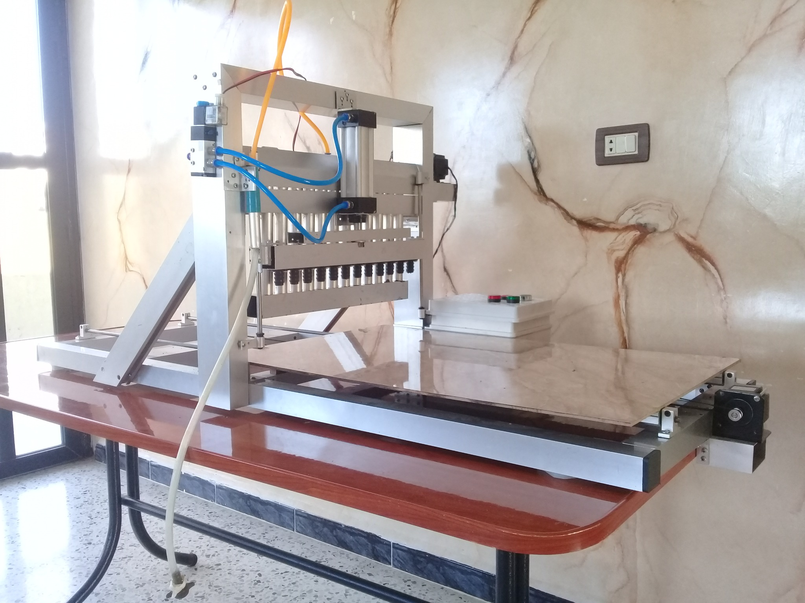
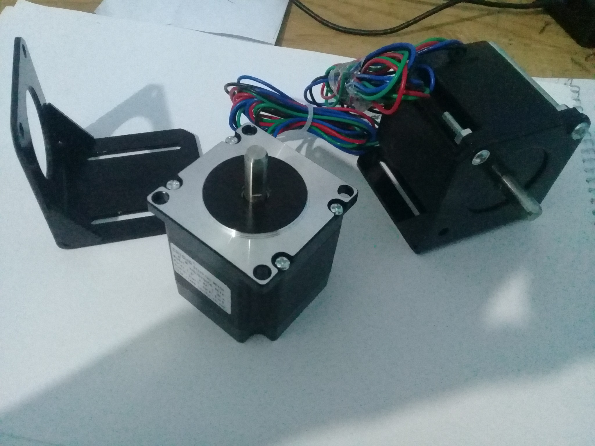
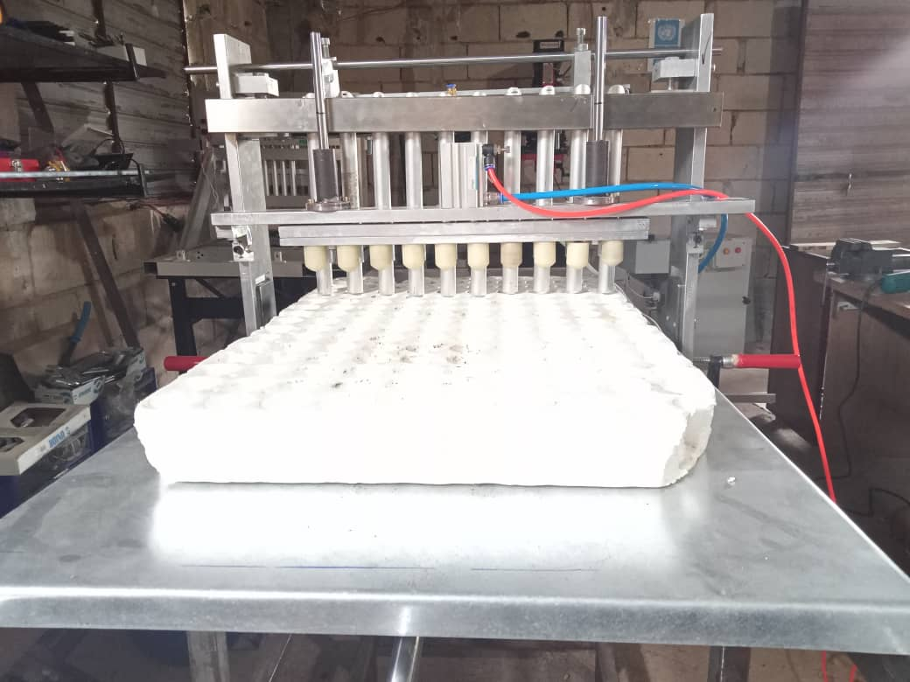
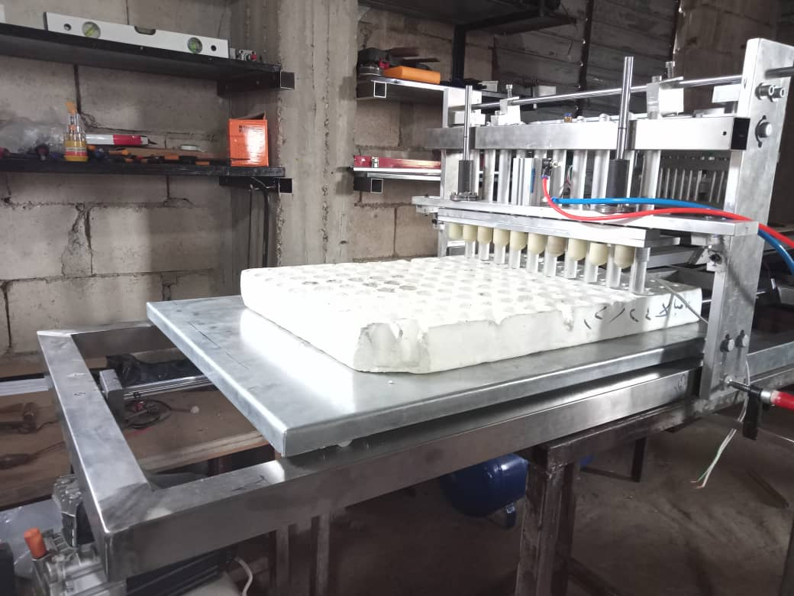
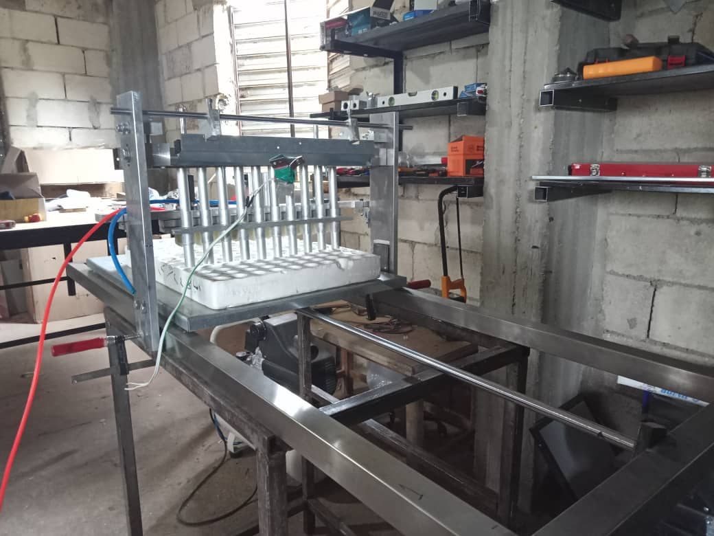
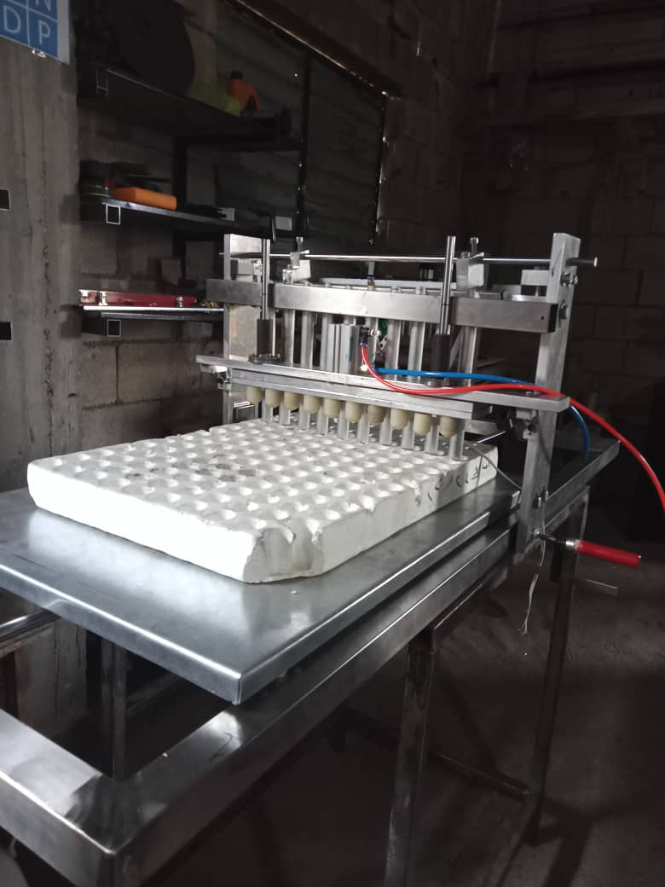

# Automated Seed Sowing Machine for Seedling Trays

A semi-automatic machine developed to place seeds in nursery trays. The graduation prototype and a later industrial version are documented separately because their actuation systems differ.

## Project versions

### Graduation prototype

The original prototype described in the graduation project. It combines stepper-motor motion with pneumatic seed-placement actuation. The included Delta PLC project belongs to this graduation prototype.

The following photographs show the stepper-motor components used in this prototype:

### Later industrial version

A later industrial implementation of the seed-tray machine. This version uses pneumatic actuation only; it does not use the stepper-motor arrangement of the graduation prototype.

## My contribution

I designed and built the graduation prototype, covering the mechanical structure, electrical and electronic systems, PLC program, and integration of the machine's actuators and controls.

## PLC project

- `plc/automated_seed_sowing_machine_for_seedling_trays.dvp` — the original Delta DVP project, renamed with an English filename.
- Open the project with compatible Delta PLC programming software (WPLSoft).

## Repository layout

- `plc/` — the graduation prototype's PLC project.
- `images/graduation-prototype/` — photographs of the original prototype.
- `images/industrial-version/` — photographs of the later pneumatic-only machine.
- `videos/` — project demonstrations.

## Recognition

The graduation project received a US$10,000 award in the Qafzah (Leap) competition, supported by the United Nations Development Programme (UNDP).
